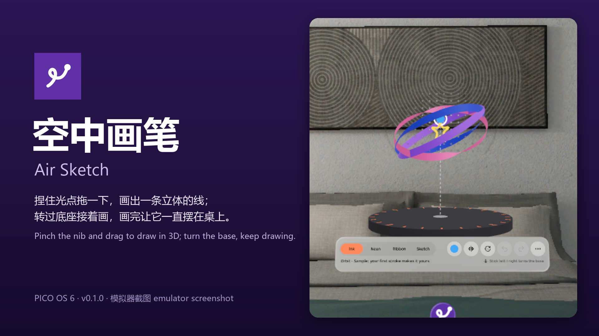
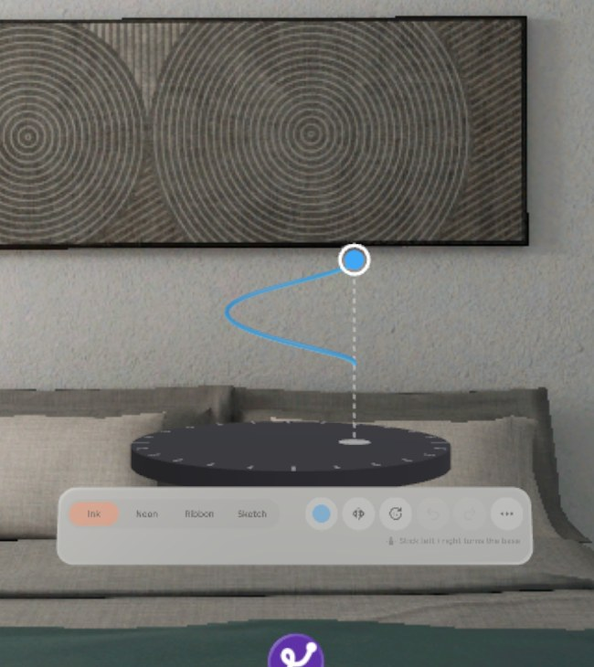
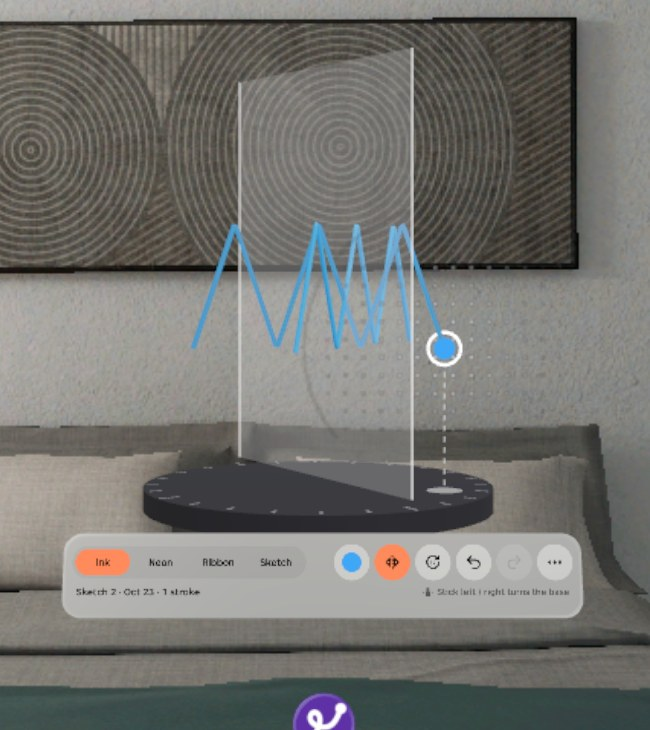
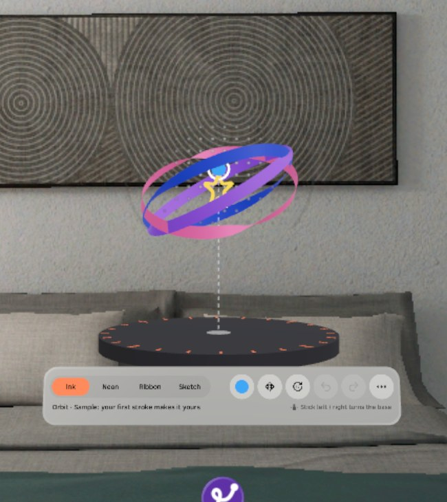
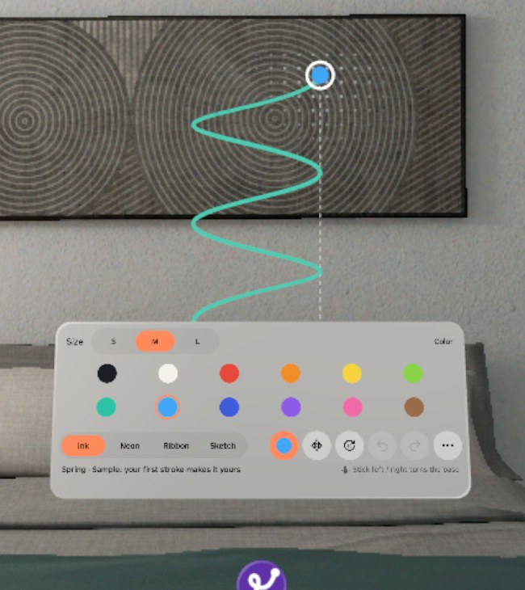
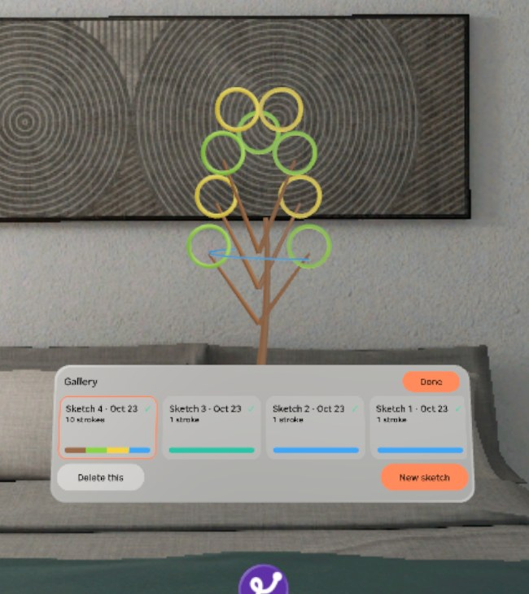
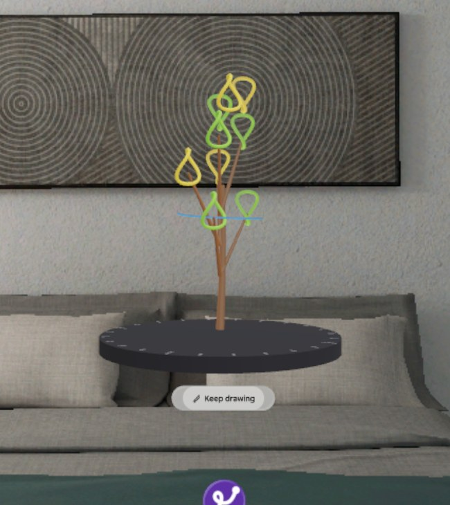

# 空中画笔 Air Sketch


一个放在桌边的小转台：捏住光点拖一下就画出一条立体的线，转过底座接着画，画完让它一直摆在那儿。PICO OS 6 应用，共享空间里的一个体积窗口（0.56 × 0.62 × 0.56 m），可以和别的窗口并排，全程离线。

A little turntable on your desk: pinch the glowing nib and drag to draw a line in 3D, turn the base to keep drawing from another side, then leave the piece on your desk. An app for PICO OS 6: one volume window (0.56 × 0.62 × 0.56 m) in the Shared Space, next to your other windows, fully offline.



> **当前状态 / Status (v0.1.0, 2026-10-23 草稿 draft)**
>
> - 模拟器 QA 第 1 轮通过：Material 门禁 0 命中，装机后 60 秒 0 崩溃，17 个设计状态全有截图，真实注入的捏住拖动能画、存档 force-stop 后还在。Emulator QA round 1 passed: no Material, no crash in 60 s, all 17 design states captured, injected pinch-drag draws and survives a force-stop.
> - 已装到头显（同一个 APK），但还没戴上测：**画线手感、真摇杆依赖真机验证**（见下文「真机依赖」）。Installed on a headset (same APK) but not yet tried on: **drawing feel and the real thumbstick depend on a device check** (see "Device-dependent").
> - 截图和视频都来自 PICO 6.1 模拟器，由调试命令和模拟器输入驱动，**不是真实手势录像**。Screenshots and video come from the PICO 6.1 emulator, driven by debug commands and injected input. **This is not a recording of real hand gestures.**

## 截图 Screenshots

| | |
| --- | --- |
|  |  |
| **画着**：捏住笔尖拖，线从笔尖后面长出来；画的时候工具条变暗，防止误触。Drawing: pinch the nib and drag; the toolbar dims while you draw. | **对称**：打开对称面，画一笔另一边同时长出镜像，撤销一次两条一起消失。Mirror: one stroke draws its mirror image too; one undo removes both. |
|  |  |
| **转底座**：左右拖底座（或点「转 90°」），作品跟着转，刻度环亮起；笔尖和落笔面不动，转过来就能从另一面接着画。Turning: drag the base or tap "turn 90°"; the piece turns, the nib stays. | **颜色与粗细**：12 色 + 3 种粗细，点圆点展开。Colour and size: 12 colours, 3 sizes. |
|  |  |
| **作品架**：最近的作品和 3 幅示例（弹簧、小树、星环），点卡片就打开，示例画下第一笔才复制成你的。Gallery: your recent pieces and three samples. | **摆着看**：只留底座和作品，可以慢慢自转，工具条缩成「✎ 接着画」小签。Display: just the piece on its base, slowly turning. |

演示视频 Demo video: [docs/media/AirSketch-demo.mp4](docs/media/AirSketch-demo.mp4)（57 s，PICO 模拟器，调试输入驱动，无声，**非真实手势录像** / emulator, debug-driven, silent, not real gestures）：画螺旋 → 转 90° → 画圆环 → 换丝带 → 对称画折线 → 撤销 / 重做 → 拖底座 → 作品架 → 摆着看。

## 怎么用 How it works

1. 捏住笔尖（带圈的光点）拖动 = 画一笔，松手结束。Pinch the nib and drag to draw; let go to finish.
2. 点笔尖周围亮着的点阵 = 笔尖在同一深度上下左右挪过去；拖底座上的影子圆点 = 笔尖前后左右挪。Tap the dots around the nib to move it in its plane; drag its shadow on the base to move it forward, back or sideways.
3. 拖底座其它地方 = 转作品；工具条上「转 90°」一次转一档。Drag the base to turn the piece, or tap "turn 90°".
4. 工具条：4 种笔刷（墨线 Ink、霓虹 Neon、丝带 Ribbon、速写 Sketch）、颜色与粗细、对称、转 90°、撤销、重做、更多（新画一幅、作品架、摆着看、清空、设置）。The toolbar holds four brushes, colour and size, mirror, turn, undo, redo and a menu.
5. 每幅最多 300 笔或 16 000 点；画满了会提示新开一幅。自动存档，下次打开接着画。Up to 300 strokes or 16,000 points per piece; saved automatically.

首次打开有三句引导（画一笔 → 点点阵 → 转一下），可以点 × 跳过。中文 / English 在设置里切换。不需要网络、相机或任何权限，没有账号，没有 API key。A three-step first-run hint can be skipped. Language is in Settings. No network, camera or permission; no account, no API key.

## 安装 Install

```bash
adb install -r AirSketch-v0.1.0.apk
pico-cli app launch io.embodit.airsketch
```

APK 在 [Release v0.1.0](../../releases/tag/v0.1.0) 里（debug 签名，sha256 `d4a8c5b14ea0d4837c4764029196eb56001811981df84aa1b2ab264aa7bd55a2`）。The APK is attached to release v0.1.0 (debug-signed).

## 构建 Build

```bash
./gradlew assembleDebug
adb install -r app/build/outputs/apk/debug/app-debug.apk
```

Needs the PICO Spatial SDK 6.1.9 and JDK 21. 12 JVM tests: `./gradlew testDebugUnitTest` (stroke sampling, smoothing, the draw-zone clamp, meshing, save format, samples inside the zone). Developer notes, debug broadcast and the screenshot tour: [AGENTS.md](AGENTS.md). How the app was made: [docs/context/CONTEXT.md](docs/context/CONTEXT.md).

## 已知问题 Known issues (v0.1.0)

来自 QA 第 1 轮，都不挡使用。From QA round 1; none blocks use.

1. 作品打不开时，提示条的原因行显示的是解析器原文（如 "Unterminated…"），而且一行放不下被截断。When a piece cannot be opened, the reason line shows the raw parser message and is cut off.
2. 模拟器上霓虹 Neon 和墨线 Ink 几乎看不出区别（看不到辉光），真机待看。On the emulator, Neon looks almost the same as Ink; to check on a device.
3. 工具条那行「摇杆左右转动底座」在头显上可能不起作用：共享空间体积窗口里，手柄追踪在头显上报 `NOT_IN_FULL_SPACE`，模拟器上报 `DEVICE_NOT_SUPPORTED`。调试输入下转底座正常。The "stick left / right turns the base" hint may not work on a headset: controller tracking reports `NOT_IN_FULL_SPACE` there. It works with debug input.
4. 撤销时最后一笔直接消失，没有设计里 0.2 秒的淡出。Undo removes the last stroke at once, without the designed 0.2 s fade.
5. 拖动量没有按体积窗口的缩放换算：把窗口放大或缩小后，拖笔尖、拖影子的手感比例会变（默认大小下正常）。Drag distances are not divided by the window scale, so the feel changes after resizing the window.
6. 停在「打不开」提示时切换语言，标题和原因行会一中一英，重新加载后正常。Switching language while the load-error strip is open mixes languages until reload.

## 真机依赖 Device-dependent

这些只能戴上头显看。These need a headset:

- 调色板贴图取色在真机上渲染是否正确（模拟器上颜色正确）。Whether palette-texture colours render correctly on the device.
- 前后（z）方向画线的手感：远距离眼手、手柄射线各画几笔，看能不能控制前后起伏。Drawing in depth with eye-hand and controller ray.
- 近场直接捏住笔尖画（手伸进体积窗口）是否触发、是否跟手。Near-field direct pinch inside the volume.
- 1 m 处眼手画直线的抖动是否 ≤ 3 mm。Jitter of a straight line at 1 m (target ≤ 3 mm).
- 16 000 点作品上再画一笔，72 fps 是否掉帧。Frame rate when drawing on a full piece.
- 真摇杆左右转底座（见已知问题 3）。The real thumbstick turning the base (known issue 3).

## 致谢 Credits

交互和笔刷思路参照 Open Brush（Apache-2.0）与 A-Painter（MIT）；本仓库没有复制它们的代码或资源。The interaction and brush ideas follow Open Brush (Apache-2.0) and A-Painter (MIT); no code or assets from them are included.

## 许可 Licence

本仓库代码为专有（私有仓库）。Code: proprietary (private repository).
